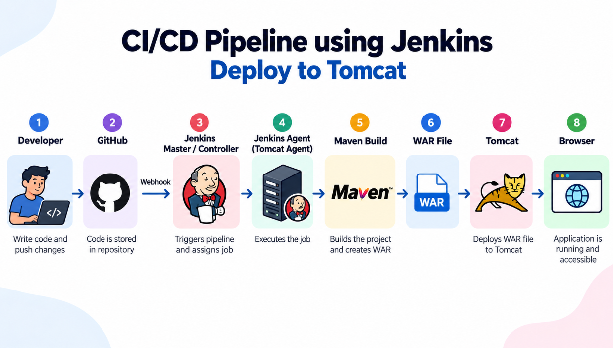

# ☕ Java Web Application Deployment using Jenkins CI/CD, Maven & Apache Tomcat

<p>


</p>

Automated the build and deployment of a **Java Servlet Web Application** using **Jenkins CI/CD, Apache Maven, and Apache Tomcat 9**.

This project demonstrates how to integrate GitHub with Jenkins, build Java applications using Maven, package applications into WAR files, and automate deployment to an Apache Tomcat server.

The implementation uses a **Jenkins Master-Agent architecture**, where Jenkins coordinates the pipeline and the Tomcat agent performs the build and deployment tasks.

---

## 📌 Project Overview

In this project, I learnt and implemented how to:

- Develop a dynamic Java Servlet web application.
- Manage source code using Git and GitHub.
- Configure Jenkins Master and Agent.
- Integrate GitHub with Jenkins.
- Build Java applications using Apache Maven.
- Understand Maven project structure and `pom.xml`.
- Package Java web applications as WAR files.
- Deploy WAR files to Apache Tomcat 9.
- Automate application deployment using Jenkins pipelines.
- Verify application deployment using HTTP requests.
- Troubleshoot build and deployment issues.

---

## Architecture

<p align="center">
  
</p>

### Project Workflow

```text
       Developer
           |
           v
    GitHub Repository
           |
      Push / Webhook
           |
           v
     Jenkins Master
           |
      Jenkins Pipeline
           |
           v
      tomcat-agent
           |
           v
      Maven Build
     mvn clean package
           |
           v
       WAR Artifact
 tomcat-practice-1.0.war
           |
           v
   Tomcat Deployment
           |
           v
 Apache Tomcat 9 :9090
           |
           v
        Browser
           |
           v
 /tomcat-practice-1.0/hello
```

### Architecture Components

| Component | Responsibility |
|---|---|
| Developer | Updates application source code |
| GitHub | Stores source code |
| Jenkins Master | Coordinates pipeline execution |
| Jenkins Agent | Performs build and deployment |
| Apache Maven | Compiles and packages the application |
| WAR Artifact | Deployable Java application |
| Apache Tomcat 9 | Hosts the Java web application |
| Browser | Accesses the deployed application |

---

## 🛠️ Technologies Used

| Category | Technology |
|---|---|
| Programming Language | Java |
| Web Technology | Java Servlet |
| Build Tool | Apache Maven |
| CI/CD | Jenkins |
| Jenkins Architecture | Master-Agent |
| Application Server | Apache Tomcat 9.0.122 |
| Packaging | WAR |
| Version Control | Git |
| Source Code Hosting | GitHub |
| Deployment | Jenkins Pipeline |
| Application Port | 9090 |

---

## 📂 Project Details

| Configuration | Value |
|---|---|
| GitHub Repository | `Mohamedthoufiq31/tomcat-project` |
| Jenkins Agent | `tomcat-agent` |
| Tomcat Version | `9.0.122` |
| Tomcat Installation | `/opt/apache-tomcat-9.0.122` |
| Deployment Directory | `/opt/apache-tomcat-9.0.122/webapps/` |
| Tomcat Port | `9090` |
| Maven Command | `mvn clean package` |
| WAR Artifact | `tomcat-practice-1.0.war` |
| Application Context | `/tomcat-practice-1.0` |

---

## 📁 Maven Project Structure

The project follows a standard Maven web application structure.

```text
tomcat-project/
│
├── src/
│   └── main/
│       ├── java/
│       │   └── .../
│       │       └── HelloServlet.java
│       │
│       └── webapp/
│           └── WEB-INF/
│               └── web.xml
│
├── pom.xml
├── Jenkinsfile
└── README.md
```

### Important Files

| File | Purpose |
|---|---|
| `pom.xml` | Defines Maven dependencies and build configuration |
| `Jenkinsfile` | Defines the Jenkins pipeline |
| `HelloServlet.java` | Implements the Java Servlet |
| `web.xml` | Web application deployment descriptor, if used |

---

## 🚀 Step 1: Clone the GitHub Repository

```bash
git clone https://github.com/Mohamedthoufiq31/tomcat-project.git

cd tomcat-project
```

---

## 🚀 Step 2: Configure Maven Project

The `pom.xml` file defines the Maven project configuration.

For a Java web application, Maven uses WAR packaging.

```xml
<packaging>war</packaging>
```

Build the application:

```bash
mvn clean package
```

### Maven Build Lifecycle

| Command | Purpose |
|---|---|
| `mvn clean` | Removes previous build output |
| `mvn compile` | Compiles Java source code |
| `mvn test` | Runs configured tests |
| `mvn package` | Packages the application |
| `mvn clean package` | Cleans and creates a new package |

After a successful build, Maven generates the WAR file inside the `target/` directory.

```text
target/
└── tomcat-practice-1.0.war
```

---

## 🚀 Step 3: Configure Jenkins Master and Agent

The project uses a Jenkins Master-Agent architecture.

### Jenkins Master

The Jenkins Master is responsible for:

- Managing Jenkins jobs and pipelines.
- Connecting to the GitHub repository.
- Coordinating pipeline execution.
- Assigning tasks to the configured agent.
- Displaying build results and console logs.

### Jenkins Agent

The Jenkins agent used in this project:

```text
tomcat-agent
```

The agent performs the application build and deployment tasks.

The agent environment requires the appropriate Java, Maven, and Tomcat configuration.

### Verify the Agent

Navigate to:

```text
Manage Jenkins
      |
      v
Nodes
      |
      v
tomcat-agent
```

Verify that the agent is online and available.

---

## 🚀 Step 4: Configure GitHub Integration

Connect the GitHub repository to Jenkins.

Repository:

```text
https://github.com/Mohamedthoufiq31/tomcat-project
```

Configure:

- GitHub repository URL.
- Source branch.
- Required Git credentials, if needed.
- Pipeline configuration.
- Webhook or polling trigger, depending on the job setup.

### GitHub Integration Workflow

```text
Developer
    |
    v
GitHub Push
    |
    v
Jenkins Trigger
    |
    v
Pipeline Execution
```

---

## 🚀 Step 5: Configure Jenkins Pipeline

The Jenkins pipeline automates the application build and deployment.

### Pipeline Stages

1. Checkout source code from GitHub.
2. Build the application using Maven.
3. Generate the WAR artifact.
4. Deploy the WAR file to Tomcat.
5. Verify the deployed application.

### Pipeline Workflow

```text
Checkout
   |
   v
Maven Build
   |
   v
WAR Artifact
   |
   v
Tomcat Deployment
   |
   v
HTTP Verification
```

### Maven Build Command

```bash
mvn clean package
```

### Generated WAR Artifact

```text
target/tomcat-practice-1.0.war
```

### Tomcat Deployment Directory

```text
/opt/apache-tomcat-9.0.122/webapps/
```

The exact Jenkinsfile syntax and stage names should match the version committed in the repository.

---

## 🚀 Step 6: Deploy WAR File to Apache Tomcat

The application server used in this project:

```text
Apache Tomcat 9.0.122
```

Installation directory:

```text
/opt/apache-tomcat-9.0.122
```

Deployment directory:

```text
/opt/apache-tomcat-9.0.122/webapps/
```

Generated WAR file:

```text
tomcat-practice-1.0.war
```

Example deployment command:

```bash
cp target/tomcat-practice-1.0.war \
/opt/apache-tomcat-9.0.122/webapps/
```

This command must execute on the Tomcat deployment host with the required permissions.

Tomcat deploys the WAR file from its `webapps` directory.

---

## 🚀 Step 7: Verify Apache Tomcat

For a Tomcat installation managed using startup scripts:

Navigate to the Tomcat binary directory:

```bash
cd /opt/apache-tomcat-9.0.122/bin
```

Start Tomcat:

```bash
./startup.sh
```

Stop Tomcat:

```bash
./shutdown.sh
```

Check whether Tomcat is listening on port `9090`:

```bash
sudo ss -lntp | grep 9090
```

---

## 🚀 Step 8: Access the Java Web Application

Open the deployed Servlet endpoint:

```text
http://54.221.60.120:9090/tomcat-practice-1.0/hello
```

Verify using curl:

```bash
curl -i http://54.221.60.120:9090/tomcat-practice-1.0/hello
```

A successful HTTP response confirms that the application endpoint is reachable.

---

## 🔄 Complete CI/CD Workflow

```text
1. Developer updates Java source code
                 |
                 v
2. Push changes to GitHub
                 |
                 v
3. Jenkins receives the trigger
                 |
                 v
4. Jenkins Master starts pipeline
                 |
                 v
5. tomcat-agent checks out source
                 |
                 v
6. Maven builds the application
                 |
                 v
7. WAR artifact is generated
                 |
                 v
8. WAR is deployed to Tomcat
                 |
                 v
9. HTTP request verifies deployment
                 |
                 v
10. Application is available in browser
```

---

## 📚 Useful Commands Summary

### Git

```bash
git clone <repository-url>

git status

git add .

git commit -m "Update Java application"

git push origin main
```

### Maven

```bash
mvn --version

mvn clean

mvn compile

mvn test

mvn package

mvn clean package
```

### Check WAR Artifact

```bash
ls -lh target/
```

### Tomcat

```bash
cd /opt/apache-tomcat-9.0.122/bin

./startup.sh

./shutdown.sh
```

### Check Tomcat Port

```bash
sudo ss -lntp | grep 9090
```

### Verify Application

```bash
curl -i http://54.221.60.120:9090/tomcat-practice-1.0/hello
```

---

## 🛠️ Troubleshooting

### Maven Build Failure

```bash
mvn clean package
```

Check:

- Java version.
- Maven installation.
- `pom.xml` configuration.
- Dependency resolution.
- Compilation errors.

### Jenkins Agent Offline

Check:

- Agent connection status.
- Java availability on the agent.
- Agent launch configuration.
- Network connectivity.
- Jenkins agent logs.

### WAR File Not Generated

```bash
ls -lh target/
```

Check Maven build output and confirm WAR packaging is configured in `pom.xml`.

### Tomcat Deployment Failure

Check:

- WAR file exists.
- Deployment directory permissions.
- Tomcat logs.
- Port `9090` availability.
- Application context path.

Tomcat logs are located under:

```text
/opt/apache-tomcat-9.0.122/logs/
```

### Application Not Accessible

Verify:

1. Tomcat is running.
2. Port `9090` is listening.
3. WAR file has been deployed.
4. Application context path is correct.
5. Firewall and AWS Security Group rules allow required traffic.

---

## 🔐 Security Considerations

- Never commit SSH private keys or passwords to GitHub.
- Store Jenkins credentials in Jenkins Credentials.
- Restrict SSH access to trusted IP addresses.
- Allow the Tomcat application port only from required sources.
- Avoid exposing Jenkins administration publicly.
- Use secure credential handling in pipeline scripts.

---

## 🚀 Future Improvements

- Add automated unit and integration tests.
- Integrate SonarQube for code quality analysis.
- Add dependency and security scanning.
- Store WAR artifacts in an artifact repository.
- Implement deployment rollback.
- Add application monitoring and centralized logging.
- Configure HTTPS for the application.
- Automate infrastructure provisioning.

These are future enhancements, not features claimed as implemented.

---

## 📚 What I Learned

Through this project, I gained practical experience with:

- Integrating GitHub with Jenkins.
- Understanding Jenkins Master-Agent architecture.
- Building Java applications using Maven.
- Understanding the Maven build lifecycle.
- Packaging Java web applications as WAR files.
- Deploying WAR artifacts to Apache Tomcat 9.
- Automating application deployment through Jenkins pipelines.
- Verifying deployment using HTTP requests.
- Troubleshooting build and deployment issues.
- Understanding the end-to-end CI/CD workflow.

This project strengthened my practical understanding of CI/CD concepts and the Java web application deployment lifecycle.

---

## 👨‍💻 Author

**Mohamed Thoufiq K**

- GitHub: [@Mohamedthoufiq31](https://github.com/Mohamedthoufiq31)
- Repository: [tomcat-project](https://github.com/Mohamedthoufiq31/tomcat-project)

---

## ⭐ Support

If you found this project useful for learning **Java, Maven, Jenkins CI/CD, and Apache Tomcat**, please consider giving the repository a star ⭐.

Your support is greatly appreciated!

---

<p align="center">
  <strong>Code • Build • Automate • Deploy</strong>
</p>
